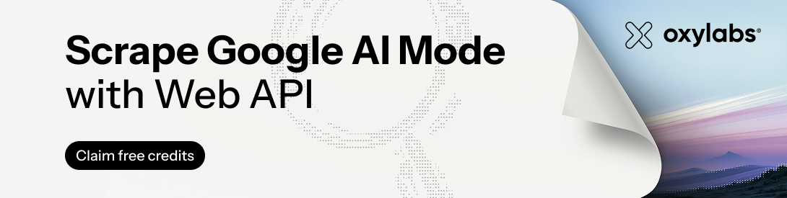
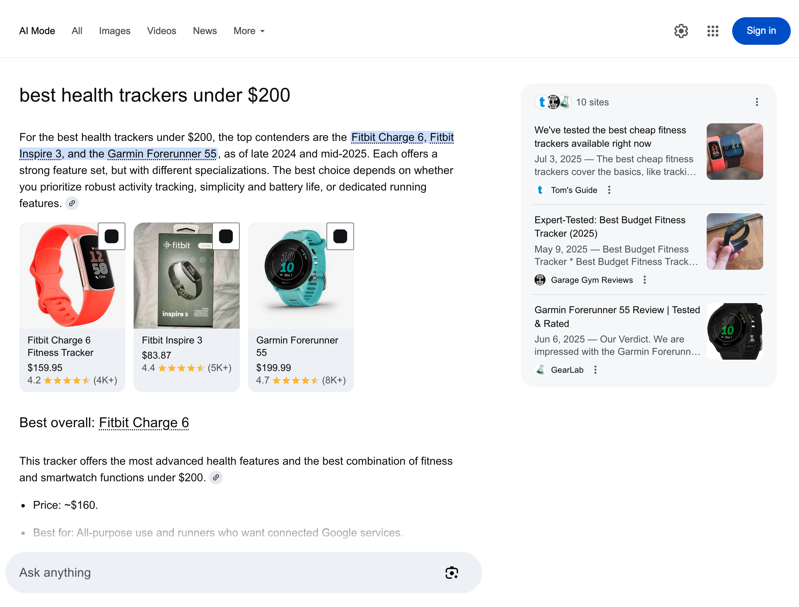

[](https://oxylabs.io/products/scraper-api/serp/google-ai-mode?utm_source=877&utm_medium=affiliate&utm_campaign=llm_scrapers&groupid=877&utm_content=google-ai-mode-scraper-github&transaction_id=102f49063ab94276ae8f116d224b67)

<a href="https://oxylabs.io"></a>
<a href="https://developers.oxylabs.io"></a>
<a href="https://dashboard.oxylabs.io"></a>
<a href="https://discord.gg/YOUR-INVITE"></a>
<a href="https://www.youtube.com/@oxylabs"></a>


# Google AI Mode Scraper

[Google AI Mode scraper](https://oxylabs.io/products/scraper-api/serp/google-ai-mode) lets you send prompts and reliably extract AI responses at scale without restrictions. Built on [Web API](https://oxylabs.io/products/web-api/scrape) and its `/search` and `/scrape` endpoints, it delivers parsed data in JSON format while handling proxies, headless browsers, and automated request systems for you. One request to the dedicated Google AI Mode scraper returns the full response text, referenced links and citations with source URLs. You can use scraped Google AI Mode data to power SEO and GEO projects, build training datasets, or support other data tasks.

## How it works

Scrape Google AI Mode responses by sending a POST request with your prompt to the Web API `/v1/scrape/google/aimode` endpoint. You authenticate with an API key, so there are no proxies, browsers or parsers to set up. See the Python example below, or explore more language samples [here](https://github.com/oxylabs/google-ai-mode-scraper/tree/main/Code%20examples).

> [!TIP]
> Get **$5 welcome credit** to try Web API for free by registering on the [dashboard](https://dashboard.oxylabs.io/).

Here is what a request involves:

1. Get your API key from the dashboard.
2. Send a POST request to `https://webapi.oxylabs.io/v1/scrape/google/aimode` with the prompt in `query`, `run_js` set to `true` and `output` set to `["json"]`.
3. Read the parsed Google AI Mode response under `results[0].json`, or set `output` to `["markdown"]` for text that is ready for LLM tools.

Google AI Mode answers can differ between identical requests, so send the same prompt more than once if you track how responses change over time.

### Request sample (Python)

First, install the requests library in your Python environment:

```bash
pip install requests
```

Then, create the following `.py` file. Make sure to use your Web API key:

```python
import json
import requests

# API parameters.
payload = {
    'query': 'best health trackers under $200',
    'run_js': True,
    'output': ['json'],
    'location': 'US',
}

# Get a response.
response = requests.post(
    'https://webapi.oxylabs.io/v1/scrape/google/aimode',
    # Replace with your API key.
    headers={'Authorization': 'Bearer YOUR_API_KEY'},
    json=payload,
    timeout=150,  # Headless rendering can take a while.
)

# Print the response to stdout.
print(response.json())

# Save the response to a JSON file.
with open('response.json', 'w') as file:
    json.dump(response.json(), file, indent=2)
```

### Request parameters

| Parameter | Description | Type |
| --- | --- | --- |
| `query` * | The prompt or question to submit to Google AI Mode. | string |
| `run_js` * | Must be `true` for this scraper, which renders Google AI Mode in a headless browser. | boolean |
| `output` | Formats to return: `markdown`, `html`, `json`, `screenshot`. Default `["html"]`. `json` returns parsed fields. | array of strings |
| `json` | Custom extraction: `{"prompt": string}` or `{"schema": object}`, never both. Overrides the built-in parser. | object |
| `location` | Two-letter country code to send the prompt from, e.g. `US`. | string |
| `device` | `desktop` (default) or `mobile`. | string |
| `callback_url` | Webhook URL for the finished job. Async only. | string |
| `storage` | Delivers the result to a bucket instead of the response: `{"type": string, "url": string}`. `type` is `s3`, `s3_gzip`, `s3_compatible`, `gcs` or `tos`. Async only. | object |

/* marks the mandatory parameters.
Check out [documentation](https://developers.oxylabs.io/api-reference/dedicated-scrapers/search-engine-scrapers#post-v1-scrape-google-aimode) to learn more.

### Output samples

#### JSON example

Below is a trimmed JSON output sample. See the full JSON output [here](https://github.com/oxylabs/google-ai-mode-scraper/blob/main/output-sample.json). A successful request returns HTTP 200 with the standard Web API envelope, and the parsed Google AI Mode fields sit under `results[].json`.

```json
{
  "status": 200,
  "results": [
    {
      "html": null,
      "markdown": null,
      "screenshot": null,
      "json": {
        "links": [
          {
            "url": "https://www.tomsguide.com/best-picks/best-cheap-fitness-trackers",
            "text": "We've tested the best cheap fitness trackers available right now"
          },
          {
            "url": "https://www.garagegymreviews.com/best-budget-fitness-tracker",
            "text": "Expert-Tested: Best Budget Fitness Tracker (2025)"
          },
          {
            "url": "...",
            "text": "..."
          }
        ],
        "prompt": "best health trackers under $200",
        "citations": [
          {
            "text": "For the best health trackers under $200, the top contenders are the Fitbit Charge 6 , Fitbit Inspire 3 , and...",
            "urls": [
              "https://www.garagegymreviews.com/best-budget-fitness-tracker",
              "https://www.techradar.com/best/best-cheap-fitness-trackers",
              "..."
            ]
          },
          {
            "text": "...",
            "urls": ["...", "..."]
          }
        ],
        "response_text": "For the best health trackers under $200, the top contenders are the Fitbit Charge 6 , Fitbit Inspire 3 , and...",
        "parse_status_code": 12000
      },
      "metadata": {
        "page": 1,
        "run_js": true,
        "url": "https://www.google.com/search?udm=50&q=best+health+trackers+under+$200&uule=w+CAIQICINdW5pdGVkIHN0YXRlcw&gl=us&hl=en&sei=vRS4aPrAL9K55OUPhfvBsAM"
      }
    }
  ],
  "params": {
    "query": "best health trackers under $200",
    "output": ["json"],
    "json": { "schema": null, "prompt": null },
    "location": "US",
    "device": "desktop",
    "run_js": true
  },
  "metadata": {
    "timestamp": 1756894406,
    "request_id": "7368949174630367233"
  }
}
```

Alternatively, you can extract the data in Markdown format by setting `output` to `["markdown"]`, to streamline integration with AI tools. Find [more details here](https://developers.oxylabs.io/products/web-api/scrape).

#### HTML example

[](/oxylabs/google-ai-mode-scraper/blob/main/html_example.png)

### JSON structure

The Google AI Mode scraper returns structured output in the standard Web API envelope, with the parsed Google AI Mode fields under `results[].json`. The table below explains each element in detail, outlining its description and data type. Depending on the prompt, both the number of items and the fields included can change.

| Key Name | Description | Type |
| --- | --- | --- |
| `status` | HTTP status code, `200` on success. | integer |
| `results` | One entry for the scraped prompt. | array |
| `results[].json` | Parsed Google AI Mode response, if `json` was requested. `null` otherwise. | object |
| `results[].json.prompt` | Original prompt submitted to Google AI Mode. | string |
| `results[].json.response_text` | Complete response text from Google AI Mode. | string |
| `results[].json.citations` | List of citations with URLs and associated texts, as shown in the main block of the Google AI Mode response. | array |
| `results[].json.citations[].text` | Text associated with the cited URLs. | string |
| `results[].json.citations[].urls` | URLs that reference that text. | array |
| `results[].json.links` | List of external links referenced in the response. Displayed in the box on the right side of the page. | array |
| `results[].json.parse_status_code` | Status code of the parsing operation. | integer |
| `results[].markdown` | Response as Markdown, if requested. `null` otherwise. | string |
| `results[].html` | Raw result markup, if requested. `null` otherwise. | string |
| `results[].screenshot` | Base64-encoded PNG image of the rendered page, if requested. `null` otherwise. | string |
| `results[].metadata.url` | URL that was fetched, after redirects. | string |
| `params` | All parameters used for the request, with applied defaults. | object |
| `metadata.timestamp` | Unix timestamp in seconds. | integer |
| `metadata.request_id` | Identifier for this request. Include it in support tickets. | string |

<!-- TODO: second banner. The old "Github repositories banner v1@2x.png" linked to the Web API early-access waitlist, which is out of date. Replace with a Web API banner and link before publishing. -->

## Batch and delivery

Web API delivers Google AI Mode results in three ways, so you can start with one prompt and scale up to thousands without changing scrapers.

| Mode | Endpoint | Max prompts per request | Best for |
| --- | --- | --- | --- |
| Realtime (sync) | `POST /v1/scrape/google/aimode` | 1 | Low-latency requests and testing |
| Async single | `POST /v1/async/scrape/google/aimode` | 1 | High concurrency and volume |
| Async batch | `POST /v1/async/scrape/batch/google/aimode` | 5,000 | Bulk ingestion |

Async requests return a job ID in `metadata.request_id`. You can poll `GET /v1/async/scrape/{jobId}` for the result, receive it at your `callback_url`, or send it straight to your own cloud storage bucket with `storage` (`s3`, `s3_gzip`, `s3_compatible`, `gcs` or `tos`). The `storage.url` value is not validated, so test the destination with a single request before you run a batch.

To send many prompts at once, pass them as an array in `query`. All other parameters apply to every prompt in the batch:

```python
import requests

# API parameters.
payload = {
    'query': [
        'best health trackers under $200',
        'best running watches for beginners',
    ],
    'run_js': True,
    'output': ['json'],
    'location': 'US',
}

# Submit the batch.
response = requests.post(
    'https://webapi.oxylabs.io/v1/async/scrape/batch/google/aimode',
    headers={'Authorization': 'Bearer YOUR_API_KEY'},  # Replace with your API key.
    json=payload,
)

# Each item in data[] holds a job ID in metadata.request_id.
print(response.json())
```

See the [Delivery Modes documentation](https://developers.oxylabs.io/products/web-api/scrape/delivery-modes) for polling, callbacks and storage details.

## Use with AI agents

Web API works with AI agents as well as scripts, so an agent can pull Google AI Mode responses on its own. Install the Agent Skills with one command:

```bash
npx skills add oxylabs/web-api-skills
```

The [MCP server](https://developers.oxylabs.io/ai-workflows/mcp) adds typed tools on top, and the two work together. If your own code makes the calls, keep the API key in an environment variable such as `OXYLABS_WEB_API_KEY`, never in source or logs.

For Google AI Mode data, these settings help agents most:

- **Markdown output:** set `output` to `["markdown"]` to get the response as text that uses far fewer tokens than HTML.
- **Location:** set `location` to the country you want the answer from, e.g. `US`.
- **Discovery:** call `GET /v1/scrapers` and `OPTIONS` on an endpoint to read the current endpoints and parameters instead of hardcoding them.

Web API also connects with agent and automation tools such as Cursor, LangChain, n8n and CrewAI. See the [for agents guide](https://developers.oxylabs.io/products/web-api/for-agents) for a full working client.

## Use cases

Scraping Google AI Mode unlocks powerful applications across SEO and GEO analysis, as well as dataset development:

- **Monitor brand presence:** track how brands appear in Google AI Mode results to strengthen visibility and reputation.
- **Track cited sources:** see which sites and pages Google AI Mode cites for your prompts, and compare them with competitors.
- **Optimize content for AI:** refine and adapt content strategies to perform better in AI-driven search interfaces.
- **Compare answers by country:** send the same prompt from different locations to see how responses change.
- **Build training datasets:** gather diverse, real-world responses to create high-quality datasets for model training or fine-tuning.
- **Ground AI agents:** give agents current Google AI Mode answers and their sources to work with.

## Why choose Oxylabs?

- **No upkeep needed:** all infrastructure handled for you (proxies, IP rotation, automated request management measures). No engineering time wasted on fixes or site changes.
- **Reliable performance:** consistent, high success rates powered by enterprise-level infrastructure, with a 177M+ rotating proxy pool across 195+ countries.
- **Smart capabilities:** a headless browser for real-user simulation, CAPTCHA handling, AI-driven fingerprinting, and geo-targeting for localized results.
- **Pay for results, not attempts:** you pay only for successfully delivered results.
- **Built for scale and agents:** sync, async and batch delivery, plus MCP support and Agent Skills.
- **Support around the clock:** 24/7 support, trusted by 15,000+ clients globally.

## Pricing

Google AI Mode is billed per successfully delivered result, and the price per 1,000 results drops as your plan grows. One subscription gives you access to every Web API scraper, not only this one. Prices below are as of November 2026, from the [Oxylabs pricing page](https://oxylabs.io/products/web-api/scrape/pricing).

| Plan | Monthly price | Google AI Mode price per 1K results | Results at that price |
| --- | --- | --- | --- |
| Free | $5 welcome credits | $1.50 | Up to 3.3K |
| Starter | $15 | $1.50 | Up to 10K |
| Basic | $100 | $1.50 | Up to 66K |
| Flexible | $500 | $1.00 | Up to 500K |
| Enterprise | From $2,500 | $0.90 | 2.78M+ |

## FAQs

### Is it allowed to scrape AI-generated content from Google?

The legality of scraping AI-generated content depends on factors like Google's terms of service, your use case, and applicable laws. We recommend consulting a legal expert before proceeding.

### Are there any limitations of Google AI Mode scraper?

Yes. The main limitation is prompt size, since requests sent to the API cannot exceed the maximum prompt length, currently 8,000 characters. Longer prompts need to be shortened before submitting. Google AI Mode is also rolling out country by country, so availability depends on where you send the prompt from, and answers can differ between identical requests.

### How do I scrape Google AI Mode at scale?

Use async delivery. Send up to 5,000 prompts in one batch request, then collect the results by polling, with a callback URL or in your own cloud storage bucket. See [Batch and delivery](#batch-and-delivery).

### Can I get Google AI Mode responses in Markdown?

Yes. Set `output` to `["markdown"]` to get the response as Markdown, which suits LLM tools and agents.

### Which countries can I send prompts from?

Set the `location` parameter to a two-letter country code, such as `US` or `DE`, to send the prompt from that country. See the [AI Mode docs](https://developers.oxylabs.io/products/web-scraper-api/targets/search-engines/google/ai-mode) for Oxylabs’ current regional notes.

## Learn more

For detailed information on API features, integrations, and more examples, see the [Web API documentation](https://developers.oxylabs.io/products/web-api).

- [Search Engine Scrapers reference](https://developers.oxylabs.io/api-reference/dedicated-scrapers/search-engine-scrapers): all Google endpoints and parameters.
- [Delivery Modes](https://developers.oxylabs.io/products/web-api/scrape/delivery-modes): realtime, async and batch.
- [Endpoint Discovery](https://developers.oxylabs.io/products/web-api/scrape/endpoint-discovery): the current list of scrapers and parameters.
- [Amazon Scraper](https://github.com/oxylabs/amazon-scraper): scrape Amazon data with the same API.

## Contact us

If you have questions or need support, reach out to us at <support@oxylabs.io>, or through live chat, accessible via the [Oxylabs Dashboard](https://dashboard.oxylabs.io/en/), or join our [Discord community](https://discord.gg/Pds3gBmKMH). You can also watch our tutorials on [YouTube](https://www.youtube.com/@oxylabs). For enterprise-related inquiries, contact your dedicated account manager.

